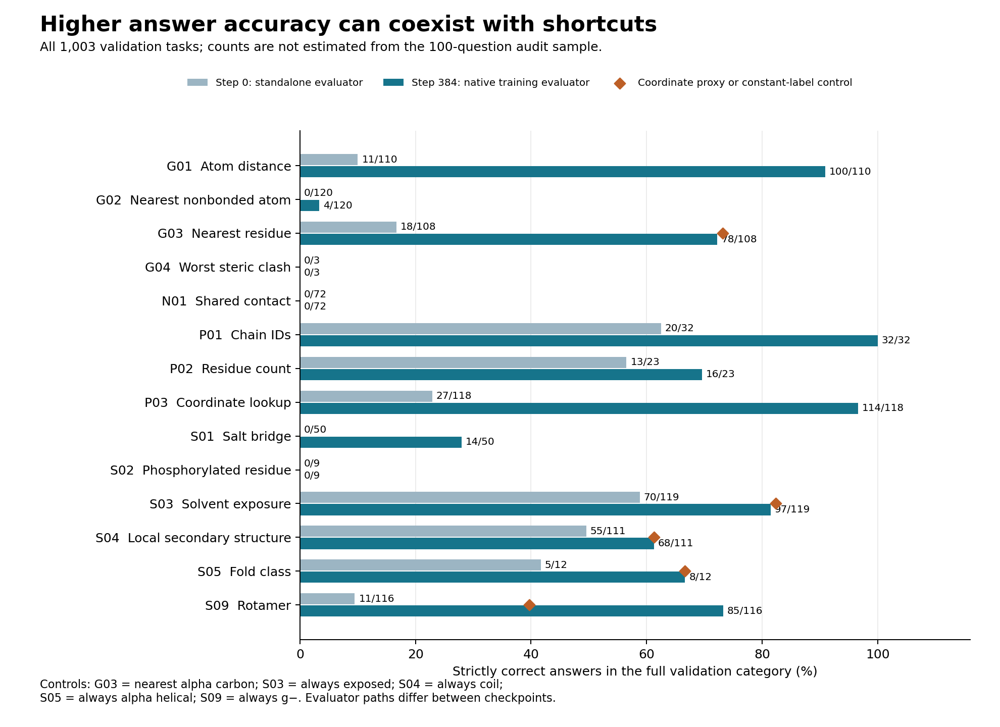
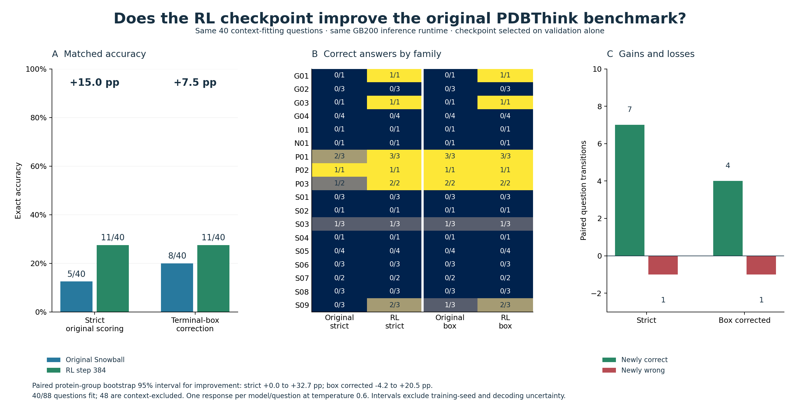
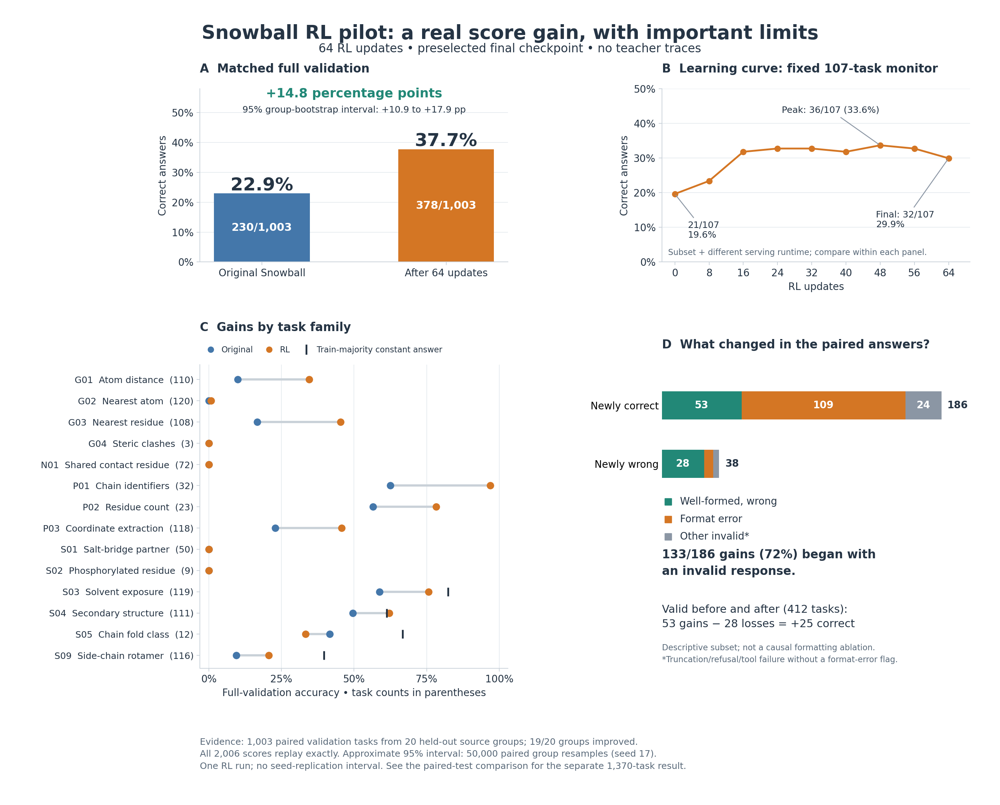
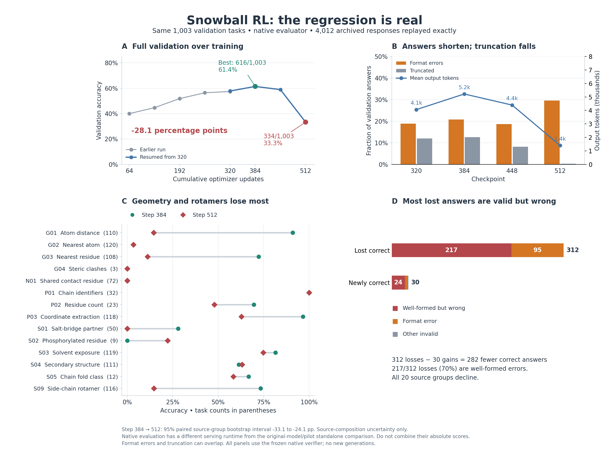
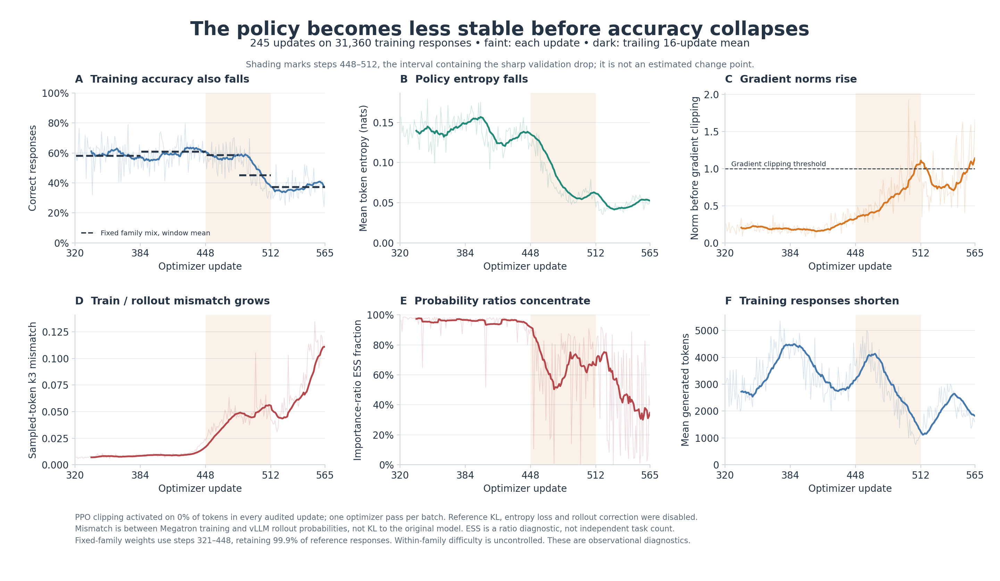

# PDBThink coordinate RL

[Issue #1](https://github.com/timodonnell/snowball-post-training/issues/1).
Train Snowball directly against PDBThink's native verifier with Marin's artifact
launcher, MarinSkyRL, Megatron, vLLM, and Iris on CoreWeave. No GLM responses or
other teacher traces are used.

**October 21 validation correction:** inspection during the
[router-replay retry](../002-pdbthink-router-replay/README.md#correction-to-previous-validation-descriptions)
found that the shared serving wrapper replaced native in-training validation's
requested temperature 0 with training temperature 1. Earlier descriptions of
that curve as greedy are incorrect. The standalone step-zero validation and
the separately deployed, matched original-benchmark comparison did not use
that wrapper. This adds a sampling difference to comparisons between the
standalone baseline and native training validation; archived responses and
their scores are unchanged.

## Paired validation rollout audit

The [updated PDF report](results/snowball-rl-result-report-with-rollout-audit.pdf)
includes the original methods/results report and a 31-page reasoning audit.
The [audit alone](results/reasoning-audit/rollout-audit.pdf) and
[paired response viewer](results/reasoning-audit/rollout-audit.html) cover **100
randomly selected validation questions at both steps 0 and 384: 200 responses**.
Every pair has a review; the viewer preserves full prompts and unabridged responses.

Selection uses seed `20261016`, stratifying by family and the joint binary
success/failure outcomes. Each family contributes seven questions, except all
three G04 and thirteen S09 questions. Allocation balances available outcome
strata, subject to capacity, then samples uniformly without replacement. The
sample spans 17 source groups. Its accuracy is deliberately unrepresentative;
all population counts below use the full validation category.

The audit supports better coordinate lookup, Euclidean distance calculations,
and some charged-atom salt-bridge calculations. It also substantially qualifies
the interpretation of the validation gains:

| Category | Full-category evidence at step 384 | Interpretation |
| --- | --- | --- |
| G03 nearest residue | 104/108 predictions match the nearest-alpha-carbon proxy; model scores 78/108, proxy 79/108 | Usually substitutes CA distances for the required minimum heavy-atom distance. |
| S03 solvent exposure | All 118 parseable answers say exposed; model 97/119, always exposed 98/119 | No demonstrated surface-area calculation. |
| S04 local secondary structure | All 110 parseable answers say coil; model and always coil both 68/111 | No demonstrated backbone/DSSP calculation. |
| S05 fold class | Model and always alpha helical both 8/12 | Gains do not establish fold classification from coordinates. |
| S09 rotamer | Model 85/116 versus 46/116 for always g−; all 13 sampled trained traces attempt geometry | More than a constant label, but no sampled trace has a fully verified calculation. |

For S09, a recurring dihedral formula omits the central-bond norm. An independent
control applying that wrong formula to the **correct** coordinates preserves
all 116 validation bins despite changing the angles. The category reward cannot
detect this error on these geometries. Four of thirteen sampled trained traces
also miscopy input coordinates; other examples lose an `atan2` quadrant or
assign a positive angle to g−. Seven still receive reward 1. The PDF gives
per-category findings, concrete examples, limitations, and all 100 case notes.

Step 0 is archived standalone inference and step 384 is native training
evaluation. Frozen prompts and scoring agree, but the execution paths differ.
This is a descriptive reasoning audit, not a matched causal estimate of RL.
Long repetitive responses were reviewed through deduplicated views and targeted
passages; not every arithmetic line was independently checked. All raw text is
preserved. The matched original-benchmark comparison below remains unchanged.



Reproducibility artifacts: [selection manifest](results/reasoning-audit/sample-manifest.json),
[all raw sampled data](results/reasoning-audit/sample.json.gz),
[annotations](results/reasoning-audit/annotations.json),
[full-category statistics](results/reasoning-audit/statistics.json),
[independent geometry](results/reasoning-audit/geometry.json), and
[artifact hashes](results/reasoning-audit/artifact-manifest.json).
The sample includes all validation families; I01/S06/S07/S08/T01 are absent
from this validation cohort and cannot be assessed by this audit.

With the frozen local validation data and archived evaluation records restored:

```bash
PYTHONPATH=experiments/001-pdbthink-coordinate .venv/bin/python experiments/001-pdbthink-coordinate/sample_reasoning_audit.py
PYTHONPATH=experiments/001-pdbthink-coordinate .venv/bin/python experiments/001-pdbthink-coordinate/analyze_reasoning_audit.py
python experiments/001-pdbthink-coordinate/plot_reasoning_audit.py
../pdbthink/.venv/bin/python experiments/001-pdbthink-coordinate/build_reasoning_audit.py
```

The sampler refuses to change an existing frozen manifest. Analysis replays all
2,006 rewards and independently checks all S09/G03 gold geometry plus sampled
G01/P03/S01 answers. NumPy/PyArrow are needed for analysis, Matplotlib for plots,
and ReportLab/Pillow/PyMuPDF for the PDF. To rebuild the viewer/PDF from committed
sample data alone, decompress `sample.json.gz` into
`runs/001/reasoning-audit/sample.json`; the committed statistics and reviews
supply the remaining inputs.

## Result report and original benchmark

The [detailed PDF report](results/snowball-rl-result-report.pdf) contains the RL
methods, full learning curves from step 0, validation-set history, plot glossary,
pilot and regression audits, and every paired original-benchmark outcome.

On October 16 we selected **checkpoint 384 using native validation alone**, before
examining original-benchmark results. It remains the best available checkpoint;
the 876-update training run is still active. We exported it with the pinned native
MarinSkyRL converter and evaluated it against a fresh original-model baseline on
matching **4-GB200 CoreWeave servers**. Both servers completed and were released.
Training continues on H100s.

The frozen original `clean-coordinate-v4.0` benchmark has 88 questions. Exactly
**40 fit Snowball's 32,768-token context**, spanning 18 families and 28 protein
groups; the other 48 are context-excluded. Both models received identical prompts
and sampling parameters, with one response per question, temperature 0.6, and the
full remaining context as the output budget. No prompts were truncated and no
tools were available.

| Matched original-benchmark score | Original Snowball | RL step 384 | Change |
| --- | ---: | ---: | ---: |
| Strict exact accuracy | 5/40 (12.5%) | 11/40 (27.5%) | +15.0 pp |
| Existing terminal-box correction | 8/40 (20.0%) | 11/40 (27.5%) | +7.5 pp |
| Strict family-macro accuracy | 13.89% | 33.33% | +19.44 pp |
| Box-corrected family-macro accuracy | 20.37% | 33.33% | +12.96 pp |

This is an encouraging point estimate with substantial uncertainty. Paired
protein-group bootstrap 95% intervals are **0.0 to +32.7 points** strictly and
**−4.2 to +20.5 points** after box normalization. Both include zero and exclude
decoding/training-seed uncertainty. Strict scoring has seven gains and one loss;
box correction leaves four gains and one loss. Three corrected gains are
previously well-formed wrong answers (G01, G03, S09); G01/G03 share one protein
group. The other gain was a refusal. Correct final values do not certify the
reasoning: some successful responses contain invented metadata or an incorrect
description of the geometric calculation, as detailed in the report.

Truncations increase from 11 to 18 and mean generated length from 3,196 to 5,369
tokens. The model still scores zero in 11 eligible families. This does not
establish broad molecular-reasoning mastery or performance on the 48 excluded
questions. The native 61.42% validation peak uses a different dataset and serving
protocol and is not substituted for this matched benchmark result.



[Paired scores](results/original-benchmark-comparison.json),
[vector figure](results/original-benchmark.pdf), and
[evidence manifest](results/original-benchmark-manifest.json) accompany the PDF.
The durable evidence archive contains all 80 raw API responses, frozen requests,
benchmark source snapshot and hashes, selection, runtime provenance, and export
verification. Its URI and SHA256 are recorded in the manifest and report.

The original benchmark source was snapshotted without modifying that repository.
All 80 historical scoring decisions (40 responses under both policies) replayed
without disagreement. Historical scores are not used as the paired control:
both baseline and trained results above come from the fresh matched runtime.

To redraw the benchmark figure from committed evidence:

```bash
python experiments/001-pdbthink-coordinate/plot_original_benchmark.py \
  --data experiments/001-pdbthink-coordinate/results/original-benchmark-comparison.json
```

To reproduce scoring and the PDF, restore the manifest's evidence archive into
`runs/001/original-benchmark` and use the original PDBThink environment (which
provides its native scorer, NumPy, ReportLab, Pillow, and PyMuPDF):

```bash
../pdbthink/.venv/bin/python experiments/001-pdbthink-coordinate/original_benchmark.py score \
  --repo ../pdbthink --output runs/001/original-benchmark
python experiments/001-pdbthink-coordinate/plot_original_benchmark.py
../pdbthink/.venv/bin/python experiments/001-pdbthink-coordinate/build_result_report.py
```

Scoring refuses changed benchmark source hashes or mismatched inference contracts.
The standalone serving helper now supports explicit GPU counts, variants and
clusters; its existing H100 defaults for the final-training observer are unchanged.

## Status

October 16 update: the trainer reports optimizer step **584/876** and remains
running. Full validation peaked at **616/1,003 (61.42%)**
at step 384, then fell to 591/1,003 (58.92%) at 448 and **334/1,003 (33.30%)**
at 512. Step 576 partially recovered to **398/1,003 (39.68%)**. The step-384 checkpoint remains complete and eligible for selection.
The [regression audit](#regression-audit) finds a real loss of answer quality and
an optimization-stability weakness: PPO clipping is inactive in this single-pass
recipe, with no reference-KL, entropy, or rollout-mismatch correction. Entropy
falls and training/rollout mismatch grows before accuracy collapses. These
observations support policy collapse, but do not isolate its initiating cause. Training
continues toward the authorized limit, with the next full validation at 640.
See the [progress snapshot and diagnostics](results/epoch-progress-20261016.json).

The [full-pass continuation](https://wandb.ai/timodonnell/snowball-pdbthink/runs/e2s5w3qn)
was **resubmitted October 15 on 48 CoreWeave H100s**
as artifact version `2026.10.15.1`, restoring the saved step-320 policy, optimizer,
scheduler, and dataloader state. It targets step 876: 556 additional updates.
The complete checkpoint restore succeeded at 19:07 UTC, and optimizer update
321 completed at 19:21 UTC. The repeated starting validation scored 580/1,003
(57.83%), versus 576/1,003 (57.43%) before the interruption. Those four additional
correct answers occurred before further training and are not a new RL gain.
See [runtime resume verification](results/epoch-resume-startup.json).
The new coordinator is
`/bizon/checkpoints-bizon-snowball-pdbthink-epoch-2026.10.15.1-coordinator-132637f6`.
The allocation, runtime, learning rate, model, data, and evaluation protocol are
unchanged. Required trajectory publication now allows 600 seconds instead of 120.
The training limit is 96 hours and the coordinator limit is 120 hours, including
export. Completing the first pass covers 28,032 prompts; upstream omits the
final incomplete 13-task batch.

The [October 8 attempt](https://wandb.ai/timodonnell/snowball-pdbthink/runs/ppc4ryud)
failed October 10 at 00:18 UTC after optimizer step 375, when a required rollout
archive upload exceeded its 120-second deadline. Its last complete checkpoint
was step 320, so 55 updates are repeated. Complete validation improved from
401/1,003 (39.98%) at the restored pilot to 576/1,003 (57.43%) at step 320.
See [the interrupted run's validation curve](results/epoch-interruption.json)
and [the verified resume checkpoint](results/epoch-resume-step320.json).

Scale-up evaluates **all 1,003 validation tasks every 64 updates**, plus the
starting and terminal policies. It banks every evaluated checkpoint using native
pending HF export requests. `finish_run.py --select-validation` selects the highest
full-validation task-weighted accuracy, breaking ties by family macro accuracy
and then earlier step; the starting step-320 checkpoint is also eligible. Selection
is saved before the paired 1,370-task test. Test scores do not influence selection.
The observer verifies terminal publication even if worker teardown stalls, exports
the selected checkpoint with the native MarinSkyRL exporter, and runs the paired
standalone validation/test comparisons. Progress is saved in
`runs/001/epoch-v2-followup-status.json`; the observer discovers the new W&B run
by its unique checkpoint root. During training, W&B's native `eval/all/avg_score`
and `eval/<family>/avg_score` histories report validation; the local status file
also records the best checkpoint. The observer publishes derived selection and
final summaries after training ends, so the active trainer cannot overwrite them.
It reuses the completed original-model test baseline. A selected initial
checkpoint can be exported from the stopped source run after verifying its
native completion marker and state, without treating the failed run as successful.
Failure status retains the last progress and validation curve. This is a detached
local observer, not an app notification service or an automatic training retry.

The [64-update pilot](https://wandb.ai/timodonnell/snowball-pdbthink/runs/xlyyl24u)
completed training successfully on 48 CoreWeave H100s. All six training tasks
exited successfully, the final checkpoint and HF export are saved, and the
training GPUs are released. This pilot sampled at most 2,048 prompts from the
28,045-task pool; it was not a full epoch.

| Measurement | Original Snowball | Trained | Change |
| --- | ---: | ---: | ---: |
| Pilot fixed monitor (107 validation tasks) | 21/107 (19.63%) | 32/107 (29.91%) | +10.28 pp |
| Two-update smoke, full validation | 230/1,003 (22.93%) | 242/1,003 (24.13%) | +1.20 pp |
| Pilot full validation | 230/1,003 (22.93%) | 378/1,003 (37.69%) | +14.76 pp |
| Pilot paired test | 291/1,370 (21.24%) | 433/1,370 (31.61%) | +10.36 pp |

The completed pilot full validation gained 186 correct answers and lost 38.
Family-macro accuracy rose from 23.44% to 35.25%. Atom-distance questions improved
from 10.0% to 34.5%, nearest-residue questions from 16.7% to 45.4%, coordinate
extraction from 22.9% to 45.8%, and solvent exposure from 58.8% to 75.6%.
G04, N01, S01 and S02 remain at zero; G02 is 1/120. Chain fold classification
fell from 5/12 to 4/12. Format errors fell from 419 to 256, while context-limit
truncations increased from 138 to 189. The completed paired pilot test gained
192 correct answers and lost 50 ([paired results](results/pilot-test-comparison.json)).
The resumed scaled checkpoint has not yet been
evaluated on the final test.



The [critical analysis](results/pilot-evidence.md) reproduces all 2,006 native
scores and independently recomputes 336 coordinate-based gold answers. The
validation tasks come from only 20 source groups; 19 improve, with an approximate
95% paired group-bootstrap interval of +10.9 to +17.9 points. Interpretation
requires care: 133 of 186 newly correct answers were previously invalid, and
three categorical families remain below a constant training-majority answer.
Secondary structure is only one correct answer above that control and predicts
`coil` on 110/111 tasks. This is strong evidence of improved benchmark performance,
with much narrower evidence for new geometric reasoning. See the
[reproducible audit data](results/pilot-evidence.json) and
[vector figure](results/pilot-evidence.pdf).

See [`results/pilot-validation-comparison.json`](results/pilot-validation-comparison.json)
for the complete paired counts and per-family results.

The pilot monitor is a small, repeatedly observed development panel. Its largest
count gains were S03 (4 to 7 of 8), S04 (2 to 4 of 8), and S09 (1 to 3 of 8).
All 107 final monitor rewards replay exactly through the frozen native verifier.
The smoke's full validation gain is modest (107 newly correct, 95 newly incorrect).
Do not compare absolute scores between the native monitor and standalone serving
as if they were the same measurement. See [`results/pilot-monitor.json`](results/pilot-monitor.json)
and [`results/smoke-validation-comparison.json`](results/smoke-validation-comparison.json).

Pilot full validation (1,003 tasks) and the paired final test (1,370 tasks) restarted
on October 8 using the preselected step-64 checkpoint. Export publication finished
at 04:06 UTC, but an Iris worker disappeared during shutdown, leaving the export
job pending and the coordinator waiting. Recovery verified successful training,
the terminal checkpoint marker, all 45 published file sizes including 39 weight
shards, metadata checksums, and unchanged tokenizer/template. The stale export
job and coordinator were cancelled. `finish_run.py --recover-step 64` records
separate recovery provenance instead of fabricating native terminal success.
The evaluation uses one eight-H100 server at a time and releases each server
on completion or failure. W&B's crashed label reflects logger shutdown;
Iris training succeeded. The native terminal monitor is preserved separately.

Auditing the smoke found one under-reward among 256 training responses:
SkyRL stripped a thinking block before verification, whereas the benchmark and
standalone evaluator score original API content. Adapter v3 scores that original
content consistently; all 470 retained smoke responses passed replay through the
corrected installed environment. See `results/adapter-v3-replay.json` for the
single correction and `runs.json` for run IDs and durable result locations.

## Regression audit

The [full-history validation figure](results/full-training-evidence.png) and
[full-history optimizer diagnostics](results/full-training-diagnostics.png)
extend the view back to step **0**, through the captured update **584**. They
include the pilot, first continuation, and resumed continuation. Discarded
updates 321–375 from the failed attempt are shown separately in gray; the
missing pilot optimizer record at 64 remains a gap. The standalone 1,003-task
evaluations at 0/64, native 107-task pilot monitor, and native 1,003-task scaled
evaluations remain separate series because their protocols differ.

This wider view shows that entropy was already decreasing during successful
learning. Declining entropy alone therefore does not identify the regression;
the later rise in training/rollout mismatch and gradient norms is more specific
to the collapse. The regression audit below remains frozen at update 565.

The full-history plots render without credentials from
[`full-training-history.json`](results/full-training-history.json):

```bash
python experiments/001-pdbthink-coordinate/plot_full_training.py
# Optional: refresh the three W&B histories, preserving their separate lineage.
PYTHONPATH=experiments/001-pdbthink-coordinate .venv/bin/python \
  -m snowball_pdbthink.full_history --refresh
```

Vector figures: [full validation history](results/full-training-evidence.pdf),
[full optimizer history](results/full-training-diagnostics.pdf).

The October 16 audit covers native validation at steps 320, 384, 448 and 512,
and every training update from 321 through 565 of the resumed run. **The leading
explanation is unstable RL optimization that increasingly concentrates the policy
on poor answers.** A growing disagreement between training and rollout
probabilities is left uncorrected, while the configured PPO clip provides no
active constraint in this single-pass setup. This is a concrete recipe weakness,
not a proven unique cause: the same settings supported the earlier gains.
The running job's recipe has not been changed by this investigation.



Validation falls from **616/1,003 at step 384 to 334/1,003 at step 512**, a loss
of 28.12 percentage points. There are 312 previously correct answers lost and
30 newly correct answers. Of the losses, **217 become well-formed but wrong**
and 95 become format errors. All 20 validation source groups decline. The paired
source-group bootstrap interval is −33.1 to −24.1 points; it measures source
composition uncertainty, not training-seed variation, serving variation, or
the effect of choosing the best checkpoint on this validation set.

| Family | Step 384 | Step 512 |
| --- | ---: | ---: |
| Atom distance (G01) | 100/110 (90.9%) | 16/110 (14.5%) |
| Nearest residue (G03) | 78/108 (72.2%) | 12/108 (11.1%) |
| Coordinate extraction (P03) | 114/118 (96.6%) | 74/118 (62.7%) |
| Side-chain rotamer (S09) | 85/116 (73.3%) | 17/116 (14.7%) |

All 54 valid step-512 rotamer answers predict `t`; the other 62 are format
errors. G01 has zero format errors at 512, so formatting cannot explain its
collapse. Mean validation output length falls from 5,220 to 1,400 tokens, while
truncations fall from 127 to 3. Shorter output accompanies degraded reasoning;
the model is not simply running out of context more often.

For example, `pdbthink-g01-02584679d3817e062c91` asks for the distance between
`(-0.792, -17.922, -10.053)` and `(2.386, 0.974, -7.489)`. At step 384, the
model computes the three correct differences and answers 19.33 Å (gold 19.332).
At step 512, it extracts both coordinates correctly, but substitutes
`sqrt((-0.792 - (-17.922))² + (-10.053 - (-7.489))²)` for the distance formula:
it mixes axes, omits a dimension, and answers 17.32. This example is the first
lost G01 task in sorted task-ID order. The audit JSON includes complete paired
responses for the first lost task in each of G01, G03, P03 and S09.

### What the checks rule out

All **4,012 validation responses** replay exactly through the frozen native
verifier, including aggregate format/truncation rates and token counts. All
four evaluations use identical task IDs, prompts, input token counts and gold
answers. The replay uses the archived original API assistant content; the
decoded-token display in eval dumps is not the verifier's input. An independent
coordinate calculation agrees with all 336 G01/G03/P03 gold answers.

All **31,360 training responses from 7,840 distinct prompts** also replay exactly.
The audit verifies prompt hashes, input token counts, family/source metadata,
gold answers, unshaped versus shaped reward, and model-version provenance.
There are no recorded generation exceptions, stale policy versions, archive
publication timeouts, skipped updates or token-alignment failures in the audited
interval. SHA-256 checks pass for every one of the 7,844 native archives.
This rules out a changed verifier, changed validation cohort, corrupted prompts,
or an explicit length penalty as the observed explanation. It does not rule
out implicit length effects from the learning objective.

Training performance declines too. Holding family proportions fixed to their
pooled mix at steps 321–448 gives success rates of **60.8% at 385–448, 58.6% at
449–480, 45.0% at 481–512, and 37.2% at 513–565**. Families absent from at least
one window (I01/S06) are excluded and weights renormalized, retaining 99.85% of
reference responses. This controls family composition but not within-family
difficulty. The evidence is inconsistent with a purely held-out overfitting
explanation or a simple shift toward harder task families.

### The optimization mechanism



The resolved recipe uses GRPO, `policy_loss_type=regular`, one optimizer pass
per batch, a constant learning rate of `1e-6`, and token-mean loss reduction.
MarinSkyRL recomputes `action_log_probs` with the current training policy just
before updating ([trainer, pinned source](https://github.com/marin-community/MarinSkyRL/blob/5663f6129f53bb6aaa09549fa6cb423571503e94/skyrl-train/skyrl_train/trainer.py#L2639)).
The Megatron worker supplies these as `old_action_log_probs`
([worker](https://github.com/marin-community/MarinSkyRL/blob/5663f6129f53bb6aaa09549fa6cb423571503e94/skyrl-train/skyrl_train/workers/megatron/megatron_worker.py#L585)).
The regular objective clips `exp(new_log_probs - old_log_probs)`
([loss](https://github.com/marin-community/MarinSkyRL/blob/5663f6129f53bb6aaa09549fa6cb423571503e94/skyrl-train/skyrl_train/objective/losses.py#L90)).
With one pass and no preceding update, this ratio is one: all 245 audited updates
report exact-unit fraction 1 and PPO clip fraction 0. This is expected for a
single-pass on-policy update; it is not itself evidence of a clipping-code bug.
The configured ±0.2 clip does not bound the change made by the optimizer step.
Gradient-norm clipping at 1.0 remains active and is a different constraint.

The recipe also disables reference KL in both loss and reward, entropy loss,
and off-policy correction. Positive coefficients in the resolved defaults do
not enable those losses. The logged `generate/tis/*` exact-match metrics refer
to token transport/alignment, not an enabled importance-weight correction.

From steps 321–384 to 545–565, mean token entropy drops **0.141 → 0.053**,
raw gradient norm rises **0.197 → 1.122**, and sampled-token training/rollout
`kl_k3` mismatch rises **0.0078 → 0.1061**. The ratio ESS fraction falls
**96.3% → 36.2%**. Entropy and probability-ratio diagnostics deteriorate before
the sharp training-score drop. The mismatch compares Megatron probabilities
with vLLM rollout probabilities; it is **not** KL to original Snowball. ESS here
describes concentration of token probability ratios, not independent task count.
Version staleness is zero throughout; numerical/backend or weight-transfer
differences can still exist at the same nominal policy version.

Taken together, these support a feedback loop of increasingly concentrated
outputs and poorly constrained updates, potentially amplified by uncorrected
training/rollout mismatch. They do **not** establish whether learning rate,
loss normalization, MoE/backend numerics, weight synchronization, or their
interaction initiated it. Train/eval parity and expert-block sync verification
were disabled, so silent numerical or transport faults are not conclusively
excluded. Reduced response length may be a symptom and/or part of the feedback.

The next discriminating experiment is a fresh restore of the saved step-384
and step-512 policies with weight-sync/parity checks, followed by a matched
continuation from 384 comparing the current recipe with one targeted change.
Native `behavior_clip` is a concrete candidate: it clips against the probabilities
that actually generated the tokens and is already implemented in this pinned
fork. It must not be combined with a separate TIS multiplier. A separate
lower-learning-rate control would distinguish step size from that correction.
The fork's [behavior-clipping debug note](https://github.com/marin-community/MarinSkyRL/blob/5663f6129f53bb6aaa09549fa6cb423571503e94/docs/debug-log-behavior-referenced-clipping.md)
describes an asynchronous stale-policy failure; this synchronous run has zero
version staleness, so the analogy is the loss reference, not proof of the same
failure. None of these interventions has yet been tested on Snowball.

Step 384 remains the highest-scoring saved checkpoint and has been verified
complete. Final checkpoint selection and the reserved paired test still follow
the protocol above. The pilot's separately matched test improvement remains
valid; this regression shows that longer training with the present recipe does
not reliably preserve those gains.

### Reproduce the audit and plots

[Audit data](results/epoch-regression-audit.json) contains per-step metrics,
family-adjusted windows, paired examples, the resolved recipe, and evidence
hashes. Vector figures: [validation and answer changes](results/epoch-regression-evidence.pdf),
[training diagnostics](results/epoch-regression-diagnostics.pdf).
The figures render from committed JSON without GPUs, raw responses, or credentials:

```bash
python experiments/001-pdbthink-coordinate/plot_regression.py
```

The plotting environment needs Matplotlib and NumPy (rendered with 3.9.3 and
1.26.4). The full replay uses prepared artifact v3 and evidence under
`runs/001/regression-audit`. The complete frozen evidence is preserved in a
**1.28 GB bundle in the permanent CoreWeave export prefix**, including all 7,844
native archives, raw eval dumps, recovered original API responses, W&B history,
and download/hash manifests. Its [bundle manifest](results/epoch-regression-evidence-bundle.json)
records the URI, exact length and SHA-256. To recover it, run the following Python
inside `coreweave.py` with the existing task credentials, then extract the tar
into `runs/001/regression-audit`:

```python
import hashlib
import json
import os
from pathlib import Path

import boto3
from botocore.config import Config

manifest = json.loads(Path(
    "experiments/001-pdbthink-coordinate/results/epoch-regression-evidence-bundle.json"
).read_text())
bucket, key = manifest["uri"].removeprefix("s3://").split("/", 1)
target = Path("runs/001/regression-audit-evidence-through565.tar")
target.parent.mkdir(parents=True, exist_ok=True)
client = boto3.client("s3", endpoint_url=os.environ["AWS_ENDPOINT_URL"],
                      config=Config(s3={"addressing_style": "virtual"}))
client.download_file(bucket, key, str(target))
assert target.stat().st_size == manifest["bytes"]
with target.open("rb") as stream:
    assert hashlib.file_digest(stream, "sha256").hexdigest() == manifest["sha256"]
```

The original archives live under the resumed run's
`attempts/trajectories/schema_v5/archives` in the temporary S3 prefix recorded
in `epoch-resume-launch.yaml`; eval display dumps live under the permanent export
root. To collect again from the original archives, the read-only commands below
use the native retention ledger included in the bundle. The final analysis
command runs directly against the extracted bundle:

```bash
export PYTHONPATH=experiments/001-pdbthink-coordinate
# Run these collectors inside coreweave.py to supply existing S3 credentials.
.venv/bin/python -m snowball_pdbthink.regression_audit collect-training \
  --evidence runs/001/regression-audit --prepared data/pdbthink-001-v3 \
  --retention-root "$RETENTION_ROOT" --max-step 565
.venv/bin/python -m snowball_pdbthink.regression_audit collect-evals \
  --evidence runs/001/regression-audit --prepared data/pdbthink-001-v3 \
  --retention-root "$RETENTION_ROOT"
.venv/bin/python -m snowball_pdbthink.regression_audit analyze \
  --evidence runs/001/regression-audit --prepared data/pdbthink-001-v3 \
  --config experiments/001-pdbthink-coordinate/results/epoch-resume-resolved-launch.json \
  --output experiments/001-pdbthink-coordinate/results/epoch-regression-audit.json
```

The analyzer uses the W&B history snapshot and eval-dump download manifest;
their hashes are recorded in the audit JSON. Analysis is frozen at update 565 and validation 512;
later training observations are outside these figures. The audit does not
generate new answers or use the reserved test split.

## Frozen inputs

| Input | Revision |
| --- | --- |
| `open-athena/Snowball-67B-A2B-5.7T-Mixed-RLVR-Step38` | `cfc1d845dae89b067cdc7250d0164abefa5a69cf` |
| `open-athena/pdbthink-coordinate-tasks` v1.3.0 | `3734406cb97b1702844319f9a5d860cbbf8fe660` |
| `marin-community/marin` | `44c95a7914864fdab8b74d597052e30cbc92b8cc` |
| `marin-community/MarinSkyRL` | `5663f6129f53bb6aaa09549fa6cb423571503e94` |

`cohort_manifest.json` records the parquet, tokenizer, template, verifier, and
cohort checksums. The full ID list is in the prepared artifact's `cohort.json`.
Preparation verifies the release checksums, joins the context table on task path
and prompt hash, and re-tokenizes every selected prompt using the pinned native
template with thinking enabled. Eligible tasks have at least 8,192 tokens left
in Snowball's 32,768-token context. Published splits and source groups remain
intact and disjoint:

| Split | Tasks | Purpose |
| --- | ---: | --- |
| Train | 28,045 | RL pool |
| Validation | 1,003 | Development and checkpoint selection |
| Test | 1,370 | Reserved final comparison |
| Monitor | 107 | Fixed subset of validation, at most eight per family |
| Smoke | 32 | Training subset covering 18 families and long prompts |

Validation covers 14 families. It has no T01, S06, I01, S07, or S08 examples;
do not infer held-out performance on these families. The manifest gives exact
counts for each split and family. Test covers 16 families, including S07 (three
tasks) and S08 (50 tasks); it has no T01, S06, or I01 examples.

Durable prepared input prefix:
`s3://marin-us-east-02a/marin/bizon/snowball-pdbthink/inputs/2026.10.07-v3`.
Model mirror prefix:
`s3://marin-us-east-02a/marin/bizon/snowball-pdbthink/models/cfc1d845dae89b067cdc7250d0164abefa5a69cf`.
The model mirror writes `source.json` only after all files pass size and SHA256
checks. The launcher requires that readiness manifest before allocating GPUs.

## Reward and evaluation

The model receives only `prompt.json`'s original system and user messages. Gold
answers are environment extras. No solution archive is read. No tools are
executed; structured requests explicitly disable tools. The pinned task's
`tests/coordinate_scoring` implementation decides exact `FINAL:` correctness,
including v1.3.0's inclusive numeric tolerance. Reward is binary correctness;
partial set scores are diagnostics only. Truncation, refusal, tool calls, and
oversized responses receive zero reward.

Training samples four responses per prompt at temperature 1.0 with an 8,192-token
output cap. **Evaluation uses the full remaining context**, `32768 - input_tokens`,
temperature 0, top-p 1, and one response per task. The 8K cohort reserve is not an
evaluation cap. Baseline and trained evaluations must use identical tasks and
this same budget policy. Raw responses, termination evidence, token counts,
format failures, and verifier diagnostics are retained. Transient HTTP/service
failures receive at most three identical requests with the same seed and budget;
model answers and verifier failures are never retried.

Training logs `reward/domain/<encoded-family>/avg_raw_reward` (for example,
`G01` is `_source__4701` in MarinSkyRL). `monitor.py` decodes these to family IDs
and exports overall sampled success, pass@4, loss, and gradient norm. These are
training-batch statistics. The fixed validation panel
logs `eval/<family>/avg_score` and `eval/<family>/pass_at_1` to W&B project
`timodonnell/snowball-pdbthink`. `monitor.py` produces task-weighted and family
macro curves with coverage. Monitor accuracy is a development signal, not the
full validation or test result. `evaluate.py` runs resumable full held-out
comparisons against an OpenAI-compatible endpoint and checks the server's prompt
token count against the frozen native count.

## Training configuration

`launch.py` is the configuration source and uses `@rl_build_options`. The explicit
role plan requests four eight-GPU Megatron policy nodes (TP1, PP2, EP16) on
`cw-rno2a`. Smoke adds one eight-GPU vLLM rollout node (40 H100s total); pilot adds
two (48 H100s total), each DP8/EP8. Generation dominated the measured smoke
steps, so pilot adds inference capacity with the same policy geometry. Each node requests
64 CPUs, 1,800 GB host RAM, and 1,000 GB disk, following MarinSkyRL's Snowball
Megatron recipe. Policy EP16 and 256-token log-probability chunks provide more
memory headroom after the EP8 smoke exhausted memory on its second long-context
update. The current pinned runtime supports Megatron for this model.

GRPO uses learning rate 1e-6, 32 prompts per update, four samples per prompt,
microbatch size one, gradient checkpointing, optimizer offload during rollout,
and no KL/reference model. Smoke runs two updates; pilot runs at most 64 updates
drawn from the full training pool. The optional `epoch` scale permits 876 full
batches; upstream batching may omit the final incomplete batch. A pilot does
not imply every training task has been visited.

Validation runs before training, every eight pilot updates, and at completion.
Smoke evaluates at step two. Pilot evaluation submits the complete monitor panel
in one batch to avoid repeatedly waiting for long responses in small batches.
Pilot checkpoints follow the same interval, with two
resume checkpoints retained and a terminal Hugging Face export. The epoch run
banks every 64-step checkpoint plus its terminal checkpoint for validation
selection; pending native export requests protect these candidates from rolling
retention. Only the terminal and selected models require GPU conversion. Temporary
training/trajectory artifacts follow Marin's 14-day TTL; preserve any needed
raw traces before expiry. Final exports and terminal metadata use the durable
Marin artifact prefix.

`adapter.py` is a small, checksum-pinned runtime overlay because the current
MarinSkyRL environment registry has no external plugin setting. It bundles the checksum-verified native chat template, registers
`PDBThinkEnv`, and preserves an explicitly disabled tool list in structured chat
transport. Training, loss, model, placement, and checkpoint logic remain in the
pinned upstream runtime. The exact overlay SHA256 is
`6fa472524ddea6e042905f87615f83a07fd5fee6339bd0d9f48cae5956fbc969`.

## Reproduce

From the repository root, install local preparation/evaluation tools:

```bash
uv sync --extra operations
export PYTHONPATH=experiments/001-pdbthink-coordinate
hf download open-athena/pdbthink-coordinate-tasks --repo-type dataset \
  --revision 3734406cb97b1702844319f9a5d860cbbf8fe660 --local-dir data/tasks
hf download open-athena/Snowball-67B-A2B-5.7T-Mixed-RLVR-Step38 \
  --revision cfc1d845dae89b067cdc7250d0164abefa5a69cf \
  --include '*.json' '*.jinja' --local-dir data/model-metadata
uv run python -m snowball_pdbthink.prepare --dataset data/tasks \
  --model-metadata data/model-metadata --output data/pdbthink-001
uv run python -m snowball_pdbthink.adapter build --prepared data/pdbthink-001
uv run pytest -q
```

Use a pinned Marin checkout with its CPU dependencies installed. `run_marin.py`
verifies its revision and copies this experiment into its packaged workspace.
It can use an existing compatible Marin Python environment via `--python`.

```bash
git clone https://github.com/marin-community/marin.git data/marin
git -C data/marin checkout 44c95a7914864fdab8b74d597052e30cbc92b8cc
uv sync --project data/marin --extra cpu
```

Stage data using a Marin environment (which supplies `rigging`) and mirror the
model using local operations dependencies. For a shared model cache, supply
`--model-cache /path/to/cache --keep-cache`; otherwise shards are removed from
the download cache after successful upload. `coreweave.py` supplies the existing
CoreWeave task credentials to a child command without printing or saving them.

```bash
uv run python -m snowball_pdbthink.coreweave --kubeconfig "$KUBECONFIG" -- \
  data/marin/.venv/bin/python -m snowball_pdbthink.stage \
  --prepared data/pdbthink-001 \
  --data-uri s3://marin-us-east-02a/marin/bizon/snowball-pdbthink/inputs/2026.10.07-v3
uv run python -m snowball_pdbthink.coreweave --kubeconfig "$KUBECONFIG" -- \
  .venv/bin/python -m snowball_pdbthink.stage \
  --model-uri s3://marin-us-east-02a/marin/bizon/snowball-pdbthink/models/cfc1d845dae89b067cdc7250d0164abefa5a69cf
```

First plan without `--run`. Append `--run` to submit through the Marin Iris hub.
The command below plans the corrected pilot; `smoke-launch.yaml` preserves the
actual adapter-v2 smoke configuration.
Only launch `--scale pilot` after the smoke advances optimizer steps and produces
its checkpoint/export. Use a fresh immutable calendar version for a changed run.

```bash
uv run python experiments/001-pdbthink-coordinate/run_marin.py \
  --marin data/marin --python data/marin/.venv/bin/python \
  --version 2026.10.07.1 --scale pilot \
  --data-uri s3://marin-us-east-02a/marin/bizon/snowball-pdbthink/inputs/2026.10.07-v3 \
  --model-uri s3://marin-us-east-02a/marin/bizon/snowball-pdbthink/models/cfc1d845dae89b067cdc7250d0164abefa5a69cf \
  --adapter-sha256 6fa472524ddea6e042905f87615f83a07fd5fee6339bd0d9f48cae5956fbc969
```

Inspect the coordinator and its child jobs using `iris --cluster=marin job
describe JOB_ID` and `iris --cluster=marin job logs JOB_ID`. Export the monitor
curve with the W&B run ID recorded in `runs.json`:

```bash
uv run python -m snowball_pdbthink.monitor \
  --run timodonnell/snowball-pdbthink/RUN_ID \
  --manifest data/pdbthink-001/manifest.json --output runs/001/monitor.json
uv run python -m snowball_pdbthink.evaluate \
  --tasks data/pdbthink-001/validation.parquet \
  --verifier data/pdbthink-001/native_verifier \
  --base-url http://MODEL_ENDPOINT/v1 --model SERVED_MODEL_NAME \
  --model-identity EXACT_CHECKPOINT_ID --output runs/001/validation-CHECKPOINT_ID
```

For a dedicated held-out server, use `run_marin.py --module
experiments.snowball_pdbthink.serve_evaluation --model-uri CHECKPOINT_URI --name
UNIQUE_NAME`, with the same `--marin` and `--python` arguments. This requests
eight H100s, runs the pinned Marin vLLM fork with TP1/DP8/EP8, and stops after
four hours. Its loader uses four readers and a 120-second S3 low-throughput
window, following observed model-load timeouts. These settings must match for
baseline and trained checkpoints. The base fork currently resolves to
`01911be34fac` in the pinned Marin runtime.

Use `run_marin.py --module experiments.snowball_pdbthink.evaluate_iris` with
`--endpoint /serve/UNIQUE_NAME`, absolute `--tasks`, `--verifier`, `--output`, and
`--model-identity` paths/identity. It waits for readiness and keeps its scoped
Iris capability in process memory. It never prints or saves that capability.
Stop the dedicated server after evaluation with `iris --cluster=marin job cancel
/bizon/UNIQUE_NAME`; a completed evaluator does not itself stop the server.

Use different output directories for baseline and trained checkpoints. Record
the selected checkpoint before evaluating test; report all family counts,
macro and task-weighted accuracy, coverage, formatting, truncation, and token
usage. Sparse monitor gains alone are insufficient to claim improvement.

Compare complete paired runs with `python -m snowball_pdbthink.compare --baseline
BASELINE_DIR --trained TRAINED_DIR --output runs/001/comparison.json`. The
comparison rejects mismatched task IDs, cohort fingerprints, metadata, or
per-task generation requests. It reports accuracy deltas and paired gains/losses
by family; these are descriptive results, not a statistical significance claim.

Audit downloaded MarinSkyRL trajectory archives with `python -m
snowball_pdbthink.audit_rollouts --tasks PREPARED_SPLIT.parquet --verifier
PREPARED/native_verifier --archives
ARCHIVE.zip ... --output AUDIT.json`. This checks runtime prompts, native token
counts, context limits, binary rewards, and generation failures, and replays
the native verifier against the
frozen inputs. Use `monitor.parquet` for monitor traces and the relevant training
parquet for training traces.

`finish_run.py` waits for a successful terminal export, starts the same Marin
evaluation server used for the baseline, evaluates the complete validation
cohort, cancels the serving job in a `finally` block, and saves a paired
comparison plus raw responses to an immutable CoreWeave results prefix. It
rejects a failed training coordinator before allocating evaluation GPUs. An
optional `--wandb-run entity/project/id` adds the full held-out results to that
run's summary. By default it leaves the test split reserved. For the final pilot,
`--test-tasks PREPARED/test.parquet --test-baseline-model-uri ORIGINAL_MODEL_URI`
also evaluates the frozen baseline and the preselected terminal checkpoint on
test. It records the checkpoint selection before making any test predictions,
reuses the trained validation server for its test evaluation, and releases that
server before starting the test baseline. Smoke runs never use this option.

Run it through `coreweave.py` and `run_marin.py --module
experiments.snowball_pdbthink.finish_run`, supplying `--terminal-uri`,
`--coordinator`, a fresh `--server-name`, absolute `--tasks`, `--verifier`,
`--baseline`, `--output`, and an immutable `--results-uri`. Keep this local
follow-up process alive while training runs. Progress is written beside the
output directory as `OUTPUT-status.json`; final artifacts are in `OUTPUT`.
Evaluation can resume completed task files with a fresh serving job name.

### Full-pass continuation

The original pilot checkpoint is an explicit artifact dependency. The launch and
follow-up commands are saved locally under `runs/001/epoch-v1-*-command.json`.
To inspect its full-validation history:

```bash
uv run python -m snowball_pdbthink.monitor \
  --run timodonnell/snowball-pdbthink/ppc4ryud \
  --manifest data/pdbthink-001-v3/manifest.json --cohort validation \
  --output runs/001/epoch-v1-monitor.json
```

[`epoch-launch.yaml`](epoch-launch.yaml) records the planned source recipe;
[`results/epoch-resolved-launch.json`](results/epoch-resolved-launch.json) records
the actual native preflight result and job geometry. Reruns need a fresh artifact
version and explicit checkpoint selection.

### Frozen-token learner/rollout diagnostic

The completed comparison is in the [five-page diagnostic report](results/parity-probe/probability-diagnostic-report.pdf),
also appended to the [full result report](results/snowball-rl-report-with-probability-diagnostic.pdf).
On the same 84,274 tokens, mean absolute log-probability disagreement increased
from 0.05719 at checkpoint 384 to 0.17820 at checkpoint 512. Forcing matching
response expert choices reduced it by 65.4% and 70.8%, respectively, with
improvement on every sampled question. All serving-weight and FP32 router-state
comparisons passed. The [plots](results/parity-probe/fixed-token-parity.png),
[checkpoint-by-text comparison](results/parity-probe/checkpoint-by-response-source.png),
and [numerical results](results/parity-probe/comparison.json) accompany the report.

The checkpoint effect is strongly text-dependent: disagreement increased on
archive-384 text but decreased slightly on archive-512 text. The experiment
identifies a routing contribution to probability mismatch; it does not prove
that mismatch caused the task-accuracy regression. Both primary panels completed.
The auxiliary decode control completed at 512; at 384 it failed before generation
after the primary panel was saved. Raw archive locations and extracted-file
hashes are recorded in [the evidence manifest](results/parity-probe/evidence-manifest.json).

`prepare_parity_probe.py` freezes two randomly selected validation questions per
present family (seed `20261017`): 28 questions across 14 families, with both the
archive-384 and archive-512 answer to each question. It preserves the original
prompt token IDs and the first 2,048 response tokens (or the entire shorter
response), totaling 56 sequences and 84,274 response tokens. The manifest records
both archive steps and their reported model versions; those labels can differ
because evaluation occurs before the next update. The probability comparison
does not reuse the historical log probabilities.

`prepare_parity_launch.py` builds two diagnostic launches that restore the native
checkpoints at completed steps 384 and 512 into fresh workers. Each requests 48
CoreWeave GB200 GPUs, retaining the original TP1/PP2/EP16 learner and two
DP8/EP8 rollout replicas. Jobs run sequentially. The GPU type and physical
placement differ from the original H100 run and must be included in the
interpretation. The original broadcast weight installation remains unchanged.

The job-local, source-hash-checked instrumentation performs these checks:

1. Independently replay learner weights through the native expert-block
   verifier into scratch buffers and compare every installed serving parameter;
   also compare learner data-parallel peers. Canonicalize the FlashInfer CUTLASS
   expert-stack layout in detached snapshots. Check all router weights and biases
   separately in full FP32 on every serving worker.
2. Rescore the identical frozen token panel with vLLM, capturing expert choices,
   then with Megatron in native mode, with reordered/rebatched inputs, and with
   vLLM's response expert choices forced through native router replay.
3. Repeat vLLM scoring after the learner forwards, with unchanged weights.
4. Generate short, checkpoint-specific responses to four questions as an auxiliary control
   comparing vLLM decode probabilities with prefill rescoring and learner scores.
   Use eight samples per question so both forward batch sizes fill the 16
   data-parallel ranks (32 responses of at most 256 tokens). The supported API
   uses a shared request seed; repeated prompts are not independent samples.

The diagnostic makes zero optimizer updates, disables evaluation/checkpoint/export
callbacks, and raises if the optimizer-training method is called. Router replay
covers captured **response input positions**; prompt routing remains native and
the last unforwarded response token has no captured route. A residual gap under
replay therefore cannot by itself rule out prompt-routing effects.

Build/stage/launch through `run_marin.py` using the `snowball_pdbthink.parity_operations`
and `snowball_pdbthink.parity_launch` modules and the usual CoreWeave credential
wrapper. Launch configurations and content-addressed instrumentation are under
`runs/001/parity-probe/`; `--validate` checks the launch without allocating GPUs.
The CPU preflight exercises the actual native collation, manifest construction,
and FineStore archive round trip for both panels. Its synthetic full-panel
learner routing records exceed 100 MB, reproducing the transaction-size failure
that occurred in the initial diagnostic. Archive writes use batches of 16 rows;
the completion manifest is written after every score batch. Synthetic preflight
values are temporary and are never used as model measurements.
After `probe/complete.json`, use `parity_download --root REMOTE_PROBE_URI --output
LOCAL_STEP_DIRECTORY` through the same wrapper to download scores/routes as
Parquet. The primary panel also has its own `fixed-panel-complete.json` marker,
written before the auxiliary decode control. If the auxiliary stage fails, use
`--fixed-panel-only` to recover the completed primary comparison; this preserves
the narrower completion marker and does not claim an auxiliary result. The
separate `--vllm-only` recovery mode is explicitly partial and cannot satisfy
the primary analysis. Then run:

```bash
uv run --with matplotlib --with numpy python \
  experiments/001-pdbthink-coordinate/analyze_parity_probe.py \
  --directory runs/001/parity-probe \
  --panel runs/001/parity-probe/frozen-panel.json.gz \
  --restore-control runs/001/parity-probe/attempt-v6-step-384 \
  --output experiments/001-pdbthink-coordinate/results/parity-probe
```

This analysis requires both completed primary `step-384/` and `step-512/`
downloads and rejects differing token identities or incomplete weight checks.
The optional `--restore-control` compares the recovered checkpoint-384 vLLM
scores with a separate fresh restore of that checkpoint. It reports probability-ratio distributions,
effective sample size, factors-of-two disagreements, and expert-set agreement.
On this fixed, family-balanced panel, mean `exp(delta) - 1 - delta` is a
descriptive mismatch statistic, **not an unbiased current-policy KL estimate**.
Fresh restores can reproduce persistent checkpoint/backend differences; they
cannot establish the historical in-memory synchronization state. Completion
markers and measured results, rather than submission status, determine whether
the check succeeded.

Interpret the paired checks jointly. Larger disagreement at checkpoint 512 on
the **same text** supports a persistent checkpoint/backend interaction beyond
changes in the sampled answers. Larger disagreement on archive-512 text under
**both checkpoints** supports a contribution from the response distribution.
Both can occur together; the second figure displays this 2×2 comparison.
Reducing disagreement by forcing response routes identifies a causal routing
contribution in this diagnostic, without proving that routing explains the
entire original regression. Rebatched and repeated forwards measure numerical
sensitivity with weights held fixed. None of these tests establishes the
historical serving weights from a checkpoint label alone.
